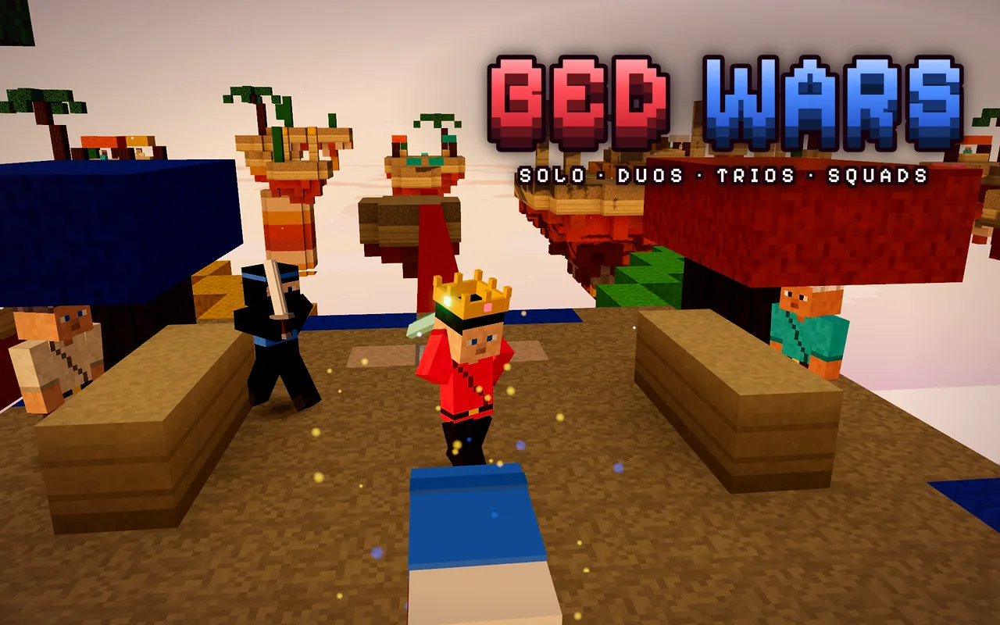
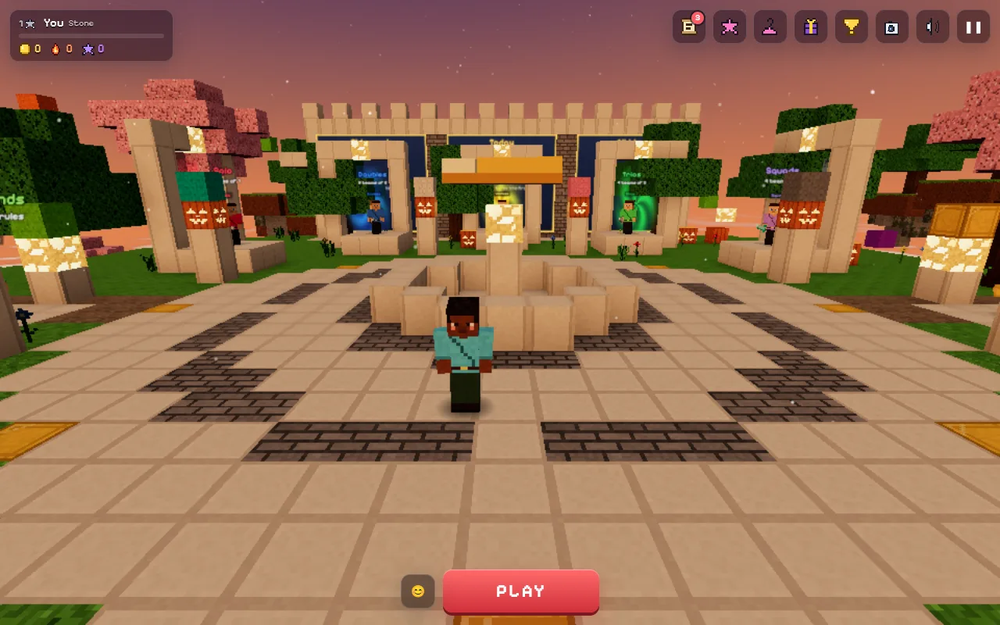
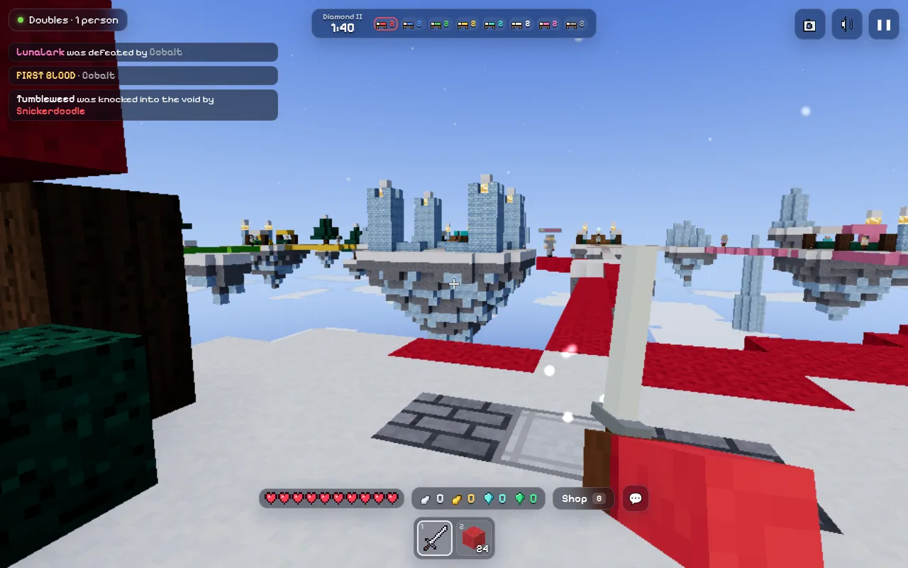

# Bed Wars

<a href="https://orbworlds.com/orb/bed-wars?utm_source=github&utm_medium=readme&utm_campaign=bedwars"></a>

Every team starts on its own island with a bed. As long as your bed stands, you come back when you die; once it's broken, you don't. Collect iron and gold at your island's forge (it keeps your share while you're away), buy blocks and gear, bridge over to the other islands and take their beds out.

You can play Solo, Doubles, Trios or Squads on ten arenas. Empty seats get bots, so a match starts right away even when you're alone. Between matches there's a lobby with a parkour course and a bridging range. Near the end of a match an earthquake starts crumbling the islands toward the middle, so games don't drag on.

**[Play it on Orb](https://orbworlds.com/orb/bed-wars?utm_source=github&utm_medium=readme&utm_campaign=bedwars)**. It runs in the browser on a computer, phone or tablet, and you
don't need an account.

<p>
  
  
</p>

## Controls

WASD to move (double-tap W or hold Ctrl to sprint), mouse to look, left click to hit or break, right click to place, Space to jump, Shift or C to sneak, B for the shop, V for first person. Every key can be changed in Menu → Controls. On a phone or tablet it plays by touch.

## Run it yourself

```bash
git clone https://github.com/orbworlds/bedwars
cd bedwars
npm install
npm start
```

That opens it at http://127.0.0.1:4242 with the [Orb kit](https://www.npmjs.com/package/@orbworlds/kit), which `npm install`
brings and which gives the game what it gets on Orb: other players (open a second tab, or press **+ Player**), saves, shared state and the shop, which charges nothing locally.
You need Node 20 or newer.

The whole thing is `index.html`, 7,681 lines of HTML, CSS and JavaScript with
[three.js](https://threejs.org) from a CDN. Edit it and the page reloads.

What it uses from Orb's world SDK (`window.orb`, typed in `@orbworlds/kit/orb.d.ts`):

- `orb.room` for multiplayer (who is here, what they are doing, messages between players)
- `orb.room.invite` for invite links that open the same room
- `orb.store` for things everyone shares, like scores
- `orb.shop` for the wardrobe, where looks are bought with Orb credits (the money from paid credits goes to the world’s maker)
- plain `localStorage` for progress, which Orb saves per player and brings along to their other devices

Outside Orb and the kit, `window.orb` isn't there and the game carries on without it.

## Make your own version

You can remix it on Orb without touching code: [open it there](https://orbworlds.com/orb/bed-wars?remix&utm_source=github&utm_medium=readme&utm_campaign=bedwars), choose
**Make my own copy** and describe what you'd change. Orb's AI makes the changes in your copy.

Or fork this repository, make your changes and push them. `npm run share` then prints a link that
brings your fork into Orb as a world of your own, credited as a remix of this one, and it stays in
sync with your fork from then on.

## Contributing

Pull requests are welcome. GitHub checks each one by playing through the game in a headless browser,
and once a change is merged it's live on Orb within about 15 minutes. [CONTRIBUTING.md](CONTRIBUTING.md)
has the details.

## License

MIT, see [LICENSE](LICENSE). The page embeds the [Pixelify Sans](https://fonts.google.com/specimen/Pixelify+Sans) font, under the SIL Open Font License 1.1. The Orb name and logo aren't covered by the license.
